  

# 🛡️ Awesome Continuous Threat Exposure Management (CTEM)

**A Curated Index of SaaS Platforms, Open-Source Tools, Adversarial Validation Frameworks & Attack Path Analyzers** 🎯

  
  
  
  
  
  

*Empowering SecOps, Red Teams, and Security Engineers to operationalize the 5 stages of CTEM: Scoping 📐, Discovery 🔍, Prioritization ⚖️, Validation ⚔️, and Mobilization 🚀.*

---

## 📑 Table of Contents

- [🌐 What is Continuous Threat Exposure Management (CTEM)?](#-what-is-continuous-threat-exposure-management-ctem)
- [📊 Sector Overview & Market Dynamics](#-sector-overview--market-dynamics)
- [☁️ SaaS & Enterprise Hosted Platforms](#️-saas--enterprise-hosted-platforms)
- [🔓 Open-Source GitHub Projects & Tooling](#-open-source-github-projects--tooling)
- [📈 Star History](#-star-history)
- [🤝 How to Contribute](#-how-to-contribute)
- [💖 Support & Sponsor](#-support--sponsor)
- [⚖️ Disclaimer](#️-disclaimer)

---

## 🌐 What is Continuous Threat Exposure Management (CTEM)?

**Continuous Threat Exposure Management (CTEM)** is an actionable cybersecurity framework formulated by Gartner that replaces sporadic vulnerability scans with an ongoing, business-aligned process of evaluating corporate exposure. CTEM operationalizes security posture through five cyclical phases:

1. 📐 **Scoping**: Defining critical business assets, identity systems, external digital perimeters, and attack surfaces.
2. 🔍 **Discovery**: Continuously cataloging vulnerabilities, cloud misconfigurations, credential leaks, and exposed assets.
3. ⚖️ **Prioritization**: Isolating the ~5% of exposures that adversaries can realistically exploit using threat intelligence and exploitability scoring.
4. ⚔️ **Validation**: Proving breach feasibility through adversarial emulation, automated penetration testing, and attack path simulation.
5. 🚀 **Mobilization**: Translating verified exposure findings into cross-functional remediation, automated mitigation, and executive communication.

---

## 📊 Sector Overview & Market Dynamics

The Continuous Threat Exposure Management (CTEM) and modern exposure management sector is valued at **$1.3B to $2.7B in 2025** and is projected to expand to **$1.5B to $3.5B in 2026** (delivering a compound annual growth rate of ~11–13% CAGR). As enterprise environments confront expanding hybrid-cloud estates and AI-driven automated attacks, CISOs are moving budgets away from point-in-time vulnerability discovery toward continuous adversarial validation and attack path modeling.

The industry reflects a **moderately fragmented and transitional market structure**:
- 🏢 **Concentrated Core (Enterprise Giants)**: Heavyweights like CrowdStrike, Qualys, Tenable, and Rapid7 anchor high-volume enterprise contracts, integrating exposure scoring into existing endpoint telemetry and consolidated security platforms.
- 🧩 **Fragmented Periphery (Specialized Innovators)**: Surrounding this core is an active ecosystem of specialized pure-play innovators (XM Cyber, Picus Security, Cymulate, Hadrian, SAFE Security) pioneering attack path algorithms, breach and attack simulation (BAS), and AI agentic offensive security.

---

## ☁️ SaaS & Enterprise Hosted Platforms

The following commercial CTEM platforms and exposure management engines are ranked in **descending order by company scale** (market capitalization / enterprise valuation):

| 🏢 Platform | 💰 Company Scale (Revenue / Valuation) | 🎯 Core Capabilities & Architecture | 🏷️ Specific Starting Pricing | 🎁 Free Tier / Trial Scope & Limits |
| :--- | :--- | :--- | :--- | :--- |
| **[CrowdStrike Falcon Exposure Management](https://www.crowdstrike.com/)** | **~$250B+ Market Cap** ($4.8B FY26 Revenue) | Real-time endpoint telemetry & CTEM; ExPRT.AI isolates the top 5% of weaponized exposures across live workloads. | Starting at **$126.99/year** per license (Tier 2: 150–299 assets, CDW listing); enterprise packages custom-quoted. | **15-day free trial**; includes Falcon Prevent NGAV, Device Control, and mobile protection (no credit card required). |
| **[Qualys VMDR with TruRisk](https://www.qualys.com/)** | **~$7.6B Market Cap** (~$669M Revenue) | Cloud-native vulnerability management & exposure prioritization with TruRisk risk-scoring engine. | Starting at **$4,415.99/year** (CDW baseline package); volume tiers scale per managed IP/asset. | **30-day free trial**; grants full-featured evaluation across the Enterprise TruRisk Platform for test environments. |
| **[Tenable ExposureAI](https://www.tenable.com/)** | **~$4.5B Market Cap** (~$995M Revenue) | Generative AI-powered exposure management built on Exposure Graph; extends visibility into AI workloads. | Starting at **$3,700/year** for 100 assets (~$37/asset/yr base VM); Tenable One suites range **$55–$90/asset/yr**. | **30-day free trial** for enterprise cloud platforms (or 7-day trial for standalone Nessus; non-commercial Nessus Essentials free for up to 5 IPs). |
| **[Rapid7 Exposure Command](https://www.rapid7.com/)** | **~$1.0B Market Cap** (~$860M Revenue) | Unified exposure management combining CAASM, EASM, and posture management (Gartner Leader). | Baseline asset tiers start around **$1.60–$2.00/asset/month** (~$19–$24/asset/yr via InsightVM foundation); Exposure Command bundles scale per asset. | **No permanent free tier**; 30-day guided POC / proof-of-value available upon sales qualification (self-serve trial limited to point modules like InsightAppSec). |
| **[XM Cyber](https://xmcyber.com/)** | **$700M Valuation** (Acquired by Schwarz Group; $140B+ parent revenue) | Hybrid cloud exposure management focusing on attack path analysis and critical asset choke points. | Cloud tiers start at **~$14,250–$14,408/year** (100–1,000 assets); AWS Marketplace lists Medium Enterprise at **$350,000/year**. | **14-day free trial / Proof of Value (PoV)**; full-feature access to simulate and analyze attack paths across scoping boundary. |
| **[Cymulate](https://cymulate.com/)** | **~$500M Valuation** (~$30M–$50M ARR) | Continuous security validation, breach and attack simulation (BAS), and exposure risk posture assessment. | Starting at **$1,500/month** (~$18,000/yr) for single vectors; full multi-vector 1,000-endpoint packages start at **~$91,000/year**. | **14-day free trial**; provides simulated attack evaluation and risk report across selected test vectors. |
| **[Picus Security Validation Platform](https://www.picussecurity.com/)** | **~$250M–$500M Valuation** (~$40M–$50M ARR) | Adversarial exposure validation proving exploitability before remediation; integrates with existing scanners. | Entry annual deployments start around **$20,000–$30,000/year** based on network choke points and simulated vectors. | **14-day free trial**; self-serve attack simulation across limited test vectors and integrations. |
| **[Balbix](https://www.balbix.com/)** *(Acquired by SAFE)* | **~$250M–$500M Valuation** (SAFE Security parent valuation) | AI-native exposure discovery and cyber risk quantification (now part of SAFE's unified CRQ/CTEM platform). | AWS Marketplace baseline for Balbix lists at **$145,000/year** (AI Assistant tier) to **$220,000/year** (10,000 assets full platform). | **No free tier or public trial**; evaluation conducted via guided personalized platform demos and scheduled enterprise POCs. |
| **[Hadrian](https://hadrian.io/)** | **$65M Total Raised** ($40M Series B, Oct 2026) | Autonomous offensive security; Atlas continuous external ASM and Nova on-demand AI penetration testing. | Nova pentests start at **€1,250 per test** (~$1,350/test excl. VAT); continuous Atlas ASM priced via annual enterprise contracts. | **No self-serve free trial**; offers a free preliminary external attack surface discovery report and personalized live demo. |
| **[Skybox Security](https://www.skyboxsecurity.com/)** *(Liquidated / Assets Acquired)* | **Assets acquired by Tufin** (Historically PE-backed / ~$30M–$85M rev) | Security posture management with network mapping and firewall rule compliance analysis. | Historical Skybox CertiFire baseline started at **€595/firewall/year** (10-license pack); broad enterprise deployments custom-quoted. | **No free tier or trial** (Operations liquidated; former customer base serviced via Tufin migration programs). |

---

## 🔓 Open-Source GitHub Projects & Tooling

To assemble a self-hosted Continuous Threat Exposure Management pipeline, security teams rely on specialized open-source tools across all 5 CTEM stages (Asset Discovery, Vulnerability Analysis, Attack Path Mapping, Exposure Validation, and Unified Prioritization).

The repositories below are ranked in **descending order by GitHub star count**. Each badge links directly to the repository's stargazers page:

### 🏆 Top Open-Source Projects (Ranked by Stars ⭐)

| 📦 Repository & Project | ⭐ GitHub Stars | 🎯 CTEM Stage & Domain | 💡 Key Features & Exposure Value |
| :--- | :--- | :--- | :--- |
| **[rapid7/metasploit-framework](https://github.com/rapid7/metasploit-framework)** |  | **Validation** ⚔️ Penetration Testing | World's premier exploitation and validation framework; enables SecOps to confirm whether detected vulnerabilities can be actively weaponized. |
| **[aquasecurity/trivy](https://github.com/aquasecurity/trivy)** |  | **Discovery** 🔍 Cloud & Container Exposure | Comprehensive scanner for container images, file systems, Git repositories, Kubernetes configurations, and cloud infrastructure misconfigurations. |
| **[projectdiscovery/nuclei](https://github.com/projectdiscovery/nuclei)** |  | **Discovery & Validation** ⚔️ Vulnerability Scanning | Fast and customizable vulnerability scanner driven by community YAML templates; automates verification of known zero-days and exposed services. |
| **[owasp/amass](https://github.com/owasp/amass)** |  | **Discovery & Scoping** 📐 Attack Surface Mapping (EASM) | In-depth network mapping and external asset discovery using active reconnaissance and OSINT data gathering to reveal external exposure. |
| **[projectdiscovery/subfinder](https://github.com/projectdiscovery/subfinder)** |  | **Discovery & Scoping** 📐 Subdomain Enumeration | Fast passive subdomain enumeration tool that maps internet-facing assets without generating invasive network noise. |
| **[redcanaryco/atomic-red-team](https://github.com/redcanaryco/atomic-red-team)** |  | **Validation** ⚔️ Adversary Emulation (BAS) | Library of scripted atomic tests mapped directly to MITRE ATT&CK; allows defenders to validate security controls against real adversarial techniques. |
| **[future-architect/vuls](https://github.com/future-architect/vuls)** |  | **Discovery** 🔍 Agentless Host Vulnerability Scanning | Agentless vulnerability scanner for Linux and FreeBSD; analyzes package states against NVD/JVN databases to uncover host exposure. |
| **[BloodHoundAD/BloodHound](https://github.com/BloodHoundAD/BloodHound)** |  | **Prioritization** ⚖️ Identity Attack Path Analysis | Graph theory engine that maps hidden lateral movement relationships and unintended Active Directory/Azure permissions to pinpoint critical choke points. |
| **[OpenCTI-Platform/opencti](https://github.com/OpenCTI-Platform/opencti)** |  | **Prioritization** ⚖️ Cyber Threat Intelligence (CTI) | Unified platform for managing cyber threat intelligence feeds, structuring knowledge, and contextualizing which exposures are under active in-the-wild exploitation. |
| **[mitre/caldera](https://github.com/mitre/caldera)** |  | **Validation** ⚔️ Automated Adversary Emulation | Scalable automated breach simulation framework built on MITRE ATT&CK; executes dynamic multi-stage red team operations to validate organizational resilience. |
| **[OWASP/Nettacker](https://github.com/OWASP/Nettacker)** |  | **Discovery & Validation** 🔍 Automated Pentesting Framework | Automated penetration testing and information-gathering framework designed for automated vulnerability searching and network exposure auditing. |
| **[DefectDojo/django-DefectDojo](https://github.com/DefectDojo/django-DefectDojo)** |  | **Prioritization & Mobilization** 🚀 Vulnerability Management (ASPM) | Orchestrates vulnerability ingestion from 150+ security tools, deduplicates findings, normalizes metrics, and triggers automated remediation tickets. |
| **[greenbone/openvas-scanner](https://github.com/greenbone/openvas-scanner)** |  | **Discovery** 🔍 Network Vulnerability Scanner | Flagship open vulnerability assessment scanner executing tens of thousands of Network Vulnerability Tests (NVTs) against enterprise assets. |
| **[praetorian-inc/noseyparker](https://github.com/praetorian-inc/noseyparker)** |  | **Discovery** 🔍 Secret & Credential Exposure Detection | High-performance CLI scanner that finds hardcoded secrets, API tokens, and credentials in source code and Git history before attackers locate them. |
| **[s-schoen/exposurenexus](https://github.com/s-schoen/exposurenexus)** |  | **CTEM Workflow** 📐 Purpose-Built CTEM Platform | The only dedicated open-source CTEM platform prototype; models the asset-observation-finding lifecycle, triage queues, and risk acceptance workflows. |

---

## 📈 Star History

---

## 🤝 How to Contribute

Contributions are warmly encouraged! Help expand this resource to keep Continuous Threat Exposure Management open and collaborative:

1. 🍴 **Fork the repository**.
2. 🌿 **Create a feature branch**: `git checkout -b feature/new-ctem-tool`.
3. 📝 **Add or update an entry** in `README.md`:
   - Follow the established table formatting.
   - For open-source tools, include the official GitHub star badge formatted as ``.
   - Ensure the repository is inserted in its correct position based on total star count.
4. 🚀 **Commit your changes**: `git commit -m "Add new CTEM project"`.
5. 📬 **Open a Pull Request** with a concise description of the tool and why it aligns with the CTEM framework.

---

## 💖 Support & Sponsor

Thank you for exploring and utilizing the **Awesome Continuous Threat Exposure Management** collection! 🌟

If you found this repository insightful or valuable to your security posture and engineering research, please consider supporting the project:

- ⭐ **Star this repository** on GitHub to amplify its reach across the cybersecurity community!
- 🍴 **Fork and share** it with your security colleagues, DevSecOps teams, and peer researchers!
- ☕ **Buy me a coffee & support ongoing research**: If you would like to sponsor this project and support future cybersecurity open-source tooling archives, visit the **[GitHub Sponsors Dashboard](https://github.com/sponsors/ishandutta2007)**!

Your support keeps this directory rigorously updated, independent, and comprehensive! 🙏

---

## ⚖️ Disclaimer

- 🛡️ This list is community-curated for educational, research, and defensive cybersecurity planning purposes. It does not constitute a formal endorsement of any specific vendor or commercial solution.
- 🔐 CTEM platforms handle sensitive corporate vulnerability disclosures, credential detections, and attack path calculations. Ensure self-hosted open-source tooling (e.g., PostgreSQL, RabbitMQ, Docker engines) is hardened and access-controlled according to compliance standards (e.g., GDPR, SOC2, ISO 27001).
- ⚙️ **CTEM Platform vs. Point Solutions**: Commercial platforms (CrowdStrike, Tenable, Qualys, Rapid7, XM Cyber) offer unified orchestration across multiple stages. Specialized tools (e.g., Nuclei for detection, BloodHound for identity graphs, Caldera/Metasploit for validation) must be chained together when designing an in-house open-source CTEM architecture.
